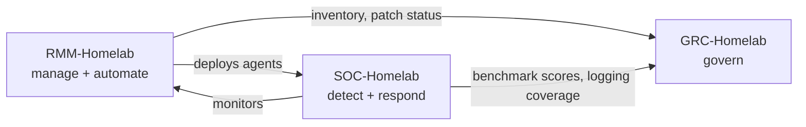

# 🧪 Caleb's Lab

**Homelab, security projects, and whatever I'm currently breaking and fixing.**

---

## 🏠 The lab

| | |
|---|---|
| 🖥️ **Compute** | Proxmox VE server running VMs, game servers, and dedicated security and management segments |
| 🌐 **Network** | Ubiquiti UDR at the edge with zone-based firewalling, Cisco Catalyst 3750-X for switching and traffic mirroring |
| 🛡️ **Security** | A SOC on its own VLAN watching the real home network |
| 🧭 **Management** | An RMM and a GRC platform on a separate management VLAN, monitored by the SOC |

---

## 🔬 Projects

I run my home network like a small organization: one program, split into three repos.

| Project | What it is | Status |
|---|---|---|
| [SOC-Homelab](https://github.com/caleb57912/SOC-Homelab) | **Detect and respond.** A Security Operations Center segment defending my home network: Splunk, Sysmon, Pi-hole, Wazuh, Zeek, Suricata, MISP, TheHive, Shuffle, Velociraptor | 🚧 Building · Phase 3 |
| [RMM-Homelab](https://github.com/caleb57912/RMM-Homelab) | **Manage and automate.** Self-hosted RMM for inventory, patching, scripting and remote access, run the way an MSP runs a client | 📐 Planned |
| [GRC-Homelab](https://github.com/caleb57912/GRC-Homelab) | **Govern.** Policies, a CIS Controls v8 assessment backed by real evidence, a risk register and compliance reporting | 📐 Planned |

### ☁️ Cloud

| Project | What it is | Status |
|---|---|---|
| [AWS-Migration-Design](https://github.com/caleb57912/AWS-Migration-Design) | **Design and migrate.** A HIPAA-aligned AWS migration for a fictional 8-clinic healthcare network: multi-AZ architecture, AWS HealthImaging for DICOM, Terraform for the full design, and a live deploy slice that's verified and then torn down | 🚧 Building · Phase 1 |

---

## 🔧 Currently working on

- Getting every log source into Splunk: firewall, switch, hypervisor, DNS and endpoint telemetry are in
- Endpoint onboarding as a single script: Sysmon, audit policy and a Splunk forwarder managed by a deployment server
- Planning the management VLAN that the RMM and GRC platforms will run on
- Designing an AWS migration for a healthcare clinic network, with a reason recorded for every architecture decision

---

## 🧰 In the lab

**Up next:**

